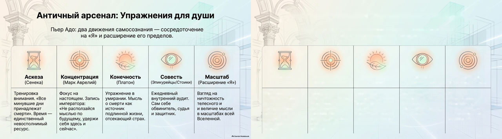

# image-slides-to-editable

A [Claude Code](https://claude.com/claude-code) skill. It turns a presentation whose slides are
pictures with baked-in text (NotebookLM / Gemini exports, screenshots, scans) into an editable deck
in [DeckCraft](https://getartcraft.com/apps/deckcraft):

- the slide picture, with its text erased, becomes the **slide background**;
- all text is re-created on top as **editable text boxes**, in the same place and at the same size.



*Left: the original slide, where the text is part of the picture. Right: the background after `erase.py`: the text is gone, and the table lines and icons are kept.*

## How it works

1. `extract.py`: takes the main picture of every slide from the `.pptx`, plus the slide size and any text already on the slide.
2. `ocr.py`: runs EasyOCR (ru + en, CPU) to find where the text lines are.
3. `erase.py`: masks the text pixels inside the OCR boxes, keeps long straight lines (borders and rules) and fills the mask with OpenCV inpainting.
4. `skeleton.py`: builds a `.pptx` whose slides have the cleaned images as their *background*.
5. You (or Claude) describe the text blocks in a small Python spec. The text is typed from the slide, and the coordinates come from `dump_ocr.py`.
6. `gen.py`: fits the font size to the width of the original lines and the line spacing to their pitch, then prints DeckCraft `batch` commands.
7. `patch_bg.py`: fixes a background inside the saved deck afterwards without redoing the text.

The full workflow that Claude follows is in [SKILL.md](SKILL.md) (in Russian).

## Install

```bash
git clone <this repo> ~/.claude/skills/image-slides-to-editable
~/.claude/skills/image-slides-to-editable/scripts/setup.sh   # venv with easyocr, opencv, python-pptx (~1.4 GB)
```

Requirements: Linux or macOS, Python 3.10+, `fc-match` (fontconfig), Noto Sans and Noto Serif fonts,
and a running DeckCraft with its MCP server connected to Claude Code.

Then ask Claude Code something like *"make the slides in deck.pptx editable: picture as background, text on top"*.

## Files

```
SKILL.md                  workflow instructions for Claude
scripts/                  setup.sh, extract.py, ocr.py, erase.py, sheet.py, skeleton.py,
                          dump_ocr.py, gen.py, patch_bg.py
examples/spec_template.py annotated spec format
examples/example_spec.py  complete real-world spec for a 15-slide deck
```
